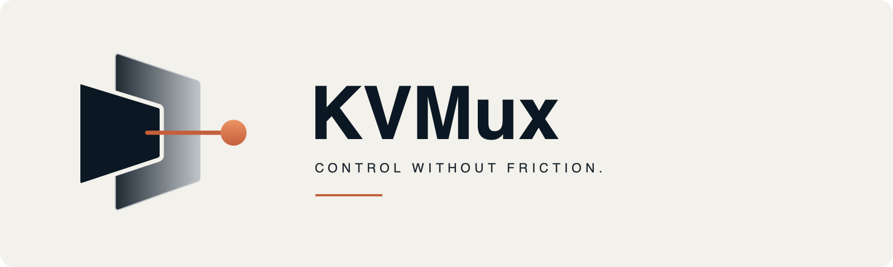

[English](README.md) | [简体中文](README.zh-CN.md)



# KVMux

View and control another computer through a USB capture card and a CH9329
keyboard/mouse controller. Attach both to the GUI computer, or run
`kvmux-relay` on another computer and connect over a trusted LAN. The capture
card and the CH9329 can be on different computers. The target computer does
not need KVMux installed.

## What you need

- A USB capture card connected to the target's video output.
- A CH9329 control cable or board, with its serial side connected to the
  computer running KVMux or the relay, and its USB HID side connected to the target.
- A computer running the desktop GUI. Hardware that is not plugged into that
  computer needs a relay computer on the trusted LAN.

```text
Target video output ──> USB capture card ──> KVMux computer
Target USB HID      <── CH9329           <── serial adapter

On one computer: the desktop GUI owns the capture card and the CH9329
Over LAN:        kvmux-relay on the hardware computer <── LAN ──> desktop GUI
```

This is a hardware KVM, not software screen sharing. Capture modes depend on
your capture card. See the [hardware guide](docs/hardware-validation.md) for
identifying the capture and serial devices.

## Get KVMux

Build from source using the [build guide](docs/building.md). The repository's
[CI](.github/workflows/ci.yml) builds and tests source; it does not publish
installer downloads. You need a C++20 compiler, CMake, Ninja and FFmpeg development
libraries, including avformat. Windows builds require an MSVC developer shell.

On macOS with a C++20 compiler and CMake installed, install Ninja and FFmpeg
with Homebrew, then build Release from the repository root:

```sh
brew install ninja ffmpeg
cmake --preset macos-release
cmake --build --preset macos-release
open build/macos-release/kvmux.app
```

The build guide lists Linux, Windows, Release and headless presets. For
common development tasks, the root Makefile detects the host preset:

```sh
make dev                 # configure and build Debug
make test                # build Debug and run tests
make lint                # formatting and static-analysis checks
make release HEADLESS=1  # headless Release build
make help                # all commands and options
```

Set `JOBS=N` to limit parallel builds. The lint tools are found on `PATH`; on
macOS, Homebrew LLVM is also detected automatically.

macOS Developer ID signing and notarization are not complete. Windows/Linux hardware
coverage, sustained performance and long-session stability remain incomplete;
see the [verification record](docs/acceptance.md) before choosing hardware.

## Use local hardware

1. Connect the capture card and CH9329 serial adapter to the GUI computer.
   On macOS, allow camera access for local capture. On Linux, your user needs
   permission to open the video device and serial port.
2. Open **Connections**. Leave **Video source** on **Local device**. Choose
   **Capture device** and **Capture mode**, then select **Start preview**.
3. Leave **Control target** on **Local serial**. Choose **Serial port** and
   **Baud rate**, then select **Connect**. The default is **9600**; use the
   actual rate configured on your CH9329.
4. Wait for fresh video and ready control. The connection popup closes when
   both are ready. Click the video to capture keyboard and mouse input; this
   first click is not sent to the target.

## Type ASCII text

Use the local text or paste field to enter text, then choose **Type**. This is
an explicit simulated typing action; it does not forward SDL text input.
KVMux accepts only US-keyboard-layout printable ASCII plus Tab and Enter.
It rejects any other character before typing starts and offers a one-click
**Remove unsupported** action that retains the supported US ASCII, Tab, and
Enter characters. Choose **Type** again after removing them. Keep the target
focused and using a US keyboard layout, because the target interprets the
simulated key presses.

Typing is paced and bounded. Cancel it or release input with the usual Host-key,
focus-loss, or connection-release path; KVMux releases active keys and stops
remaining text. Clipboard content stays local and is neither persisted nor
logged. Unicode, Chinese, and Wubi input are not supported yet.

## Capture screenshots and recordings

Open **Media** from the top menu **动作**, or from the floating KVMux logo menu.
A screenshot saves the native decoded video only—never menus, the mouse
pointer, or the status overlay—to your system **Downloads** folder as
`kvmux_YYYYMMDD_HHMMSS.jpeg`. If that name already exists, KVMux adds a suffix.

**Screenshot: Full screen** saves the whole frame. **Screenshot: Region** saves
the saved region. **Recording: Full screen** records the whole frame as an
H.264 MP4 in **Downloads**, with the same time-based name. It does not need a
region. **Recording: Region** records only the saved region. Both recordings
use the same crop path. A full-screen recording is the crop
`{0, 0, width, height}`. Confirming a region snaps it to even pixels: left
and top move to the even pixel at or before the selection, and right and
bottom move to the even pixel at or after it, staying inside the even-sized
frame. The outline, the region screenshot, region recording, and scrolling
capture all use that aligned region. A result smaller than 2×2 pixels is not
saved, and the notice says so. A crop that is still odd when recording or
scrolling starts is rejected, and the notice shows that reason.

To save a region, choose **Select region**. The picture tells you to drag,
then click **确认** or press Enter. Escape or **取消** leaves selection
without saving. Pointer events during selection stay on this computer. The
Host key stays local and is never sent to the target. A saved region stays
outlined on the preview until **Clear region**.

**Start scrolling** still needs a saved region and a control connection. Drag
the region, then capture input and scroll downward with the wheel. KVMux
samples only the next fresh frame after each downward wheel event. Use
**Finish scrolling screenshot** to save one JPEG, or cancel with Escape.
Version 1 supports only manual downward vertical scrolling. A grey menu item
explains what is missing, for example that a region has not been saved.

Use **Pause**, **Resume**, and **Stop**. **Stop** waits for the file to
finish. Screenshots and recordings stay local; they are not sent to the target
computer.

H.264 MP4 recording requires FFmpeg H.264 support. KVMux shows a clear error if
it is unavailable. Recording uses a bounded latest-frame writer, so it can drop
frames when the computer cannot keep up. This feature has not yet been validated
with physical hardware.

## Connect over LAN

**Use a trusted LAN only.** The relay has no authentication or encryption.
Anyone who can reach the relay ports can attempt to control the target. Do not
expose these ports to the Internet.

The GUI chooses **Video source** and **Control target** separately. The Hello
role must match the `kvmux-relay` process exactly. A combined relay does not
accept a video-only or control-only client, and a single-role relay does not
accept a combined client. The GUI shows `角色不匹配`.

1. On the Windows or Linux computer attached to the hardware, build and start
   the relay using the [LAN quick start](docs/lan-relay.md). For a Linux Debug
   headless build with one capture card and one recognized serial adapter on
   the same computer:

   ```sh
   build/linux-debug-headless/kvmux-relay --serve
   ```

   If automatic selection fails, use the guide's device-list commands to select
   the capture mode and serial port explicitly.
2. Allow inbound UDP **17000** (control) and **17001** (video) on that relay,
   restricted to your intended LAN. A control-only relay listens on the control
   port only. A video-only relay still listens on both ports.
3. In the GUI, open **Connections**. For this combined relay, set **Video
   source** and **Control target** to **Relay**. Enter its LAN address in both
   **Video host** and **Control host**. Keep **Video control port** and
   **Control port** at `17000`, and **Video port** at `17001`, unless you
   changed them. The same host and control port use one combined client.
4. Select **Connect relay**. Wait for fresh video and ready control, then click
   the video to capture input. Only one controller is supported.

The capture card and the CH9329 can be on different computers. These three
GUI combinations have no recorded hardware run and no recorded manual GUI
session. `--no-capture` and `--no-serial` cannot be combined.

1. Local capture, remote CH9329. On the serial computer:

   ```sh
   build/linux-debug-headless/kvmux-relay --serve --no-capture --serial "/dev/ttyUSB0" --baud 9600
   ```

   GUI: **Video source** **Local device**, **Control target** **Relay**.
2. Video from one relay and keyboard/mouse through another. On the capture
   computer, `--serve --no-serial`; on the serial computer, the `--no-capture`
   command above. GUI: both selectors **Relay**, with a different host or a
   different control port.

   ```sh
   build/linux-debug-headless/kvmux-relay --serve --no-serial --device "/dev/video0" --mode-index 0
   ```

3. Video from a relay, CH9329 on the GUI computer. Use the `--no-serial`
   command above on the capture computer. GUI: **Video source** **Relay**,
   **Control target** **Local serial**.

A control-only relay trusts the GUI's picture-freshness claim. It does not see
the picture. A video-only relay still listens on the control port for the
handshake. See
[LAN relay setup](docs/lan-relay.md#put-the-capture-card-and-the-ch9329-on-different-computers)
for ports, role matching, and the same unverified status.

MJPEG pass-through is the default network video format. Raw capture supports four explicit profiles: `--encoding h264-quality|h264-size|h265-quality|h265-size`. See [LAN relay setup](docs/lan-relay.md#choose-h264h265-encoding)
for encoder requirements and the GUI's **Decode** setting.

## Release input and open the menu

Press the **Host key** to return to Preview. It is never sent to the target.
The defaults are **Right Command** on macOS and **Right Control** on Windows/Linux.
In **Connections**, you can instead choose **Host: Right Control** on macOS or
**Host: Right GUI** on Windows/Linux.

The top menu hides while input is captured or recovering. Click the translucent
KVMux logo floating button to release input and open its menu. Drag the button
to move it without sending that drag to the target. In **Relative** mouse mode,
press Host to unlock the pointer first. In fullscreen, move to the top edge
after release to show the top menu. **Status overlay** toggles the bottom metrics;
**Diagnostics** shows connection details. The floating position and overlay
visibility are not saved.

System-reserved shortcuts may stay on your own computer. Use **Send Ctrl+Alt+Del**
or **Send Alt+Tab** in **Connections** when needed. If input stays held after a
serial-link failure, software cannot confirm its release; reconnect the target's
USB HID cable if needed. For video, input or serial problems, see
[LAN troubleshooting](docs/lan-relay.md#troubleshooting-video-appears-but-input-does-not-work).

## Further reading

- [Build options and dependencies](docs/building.md)
- [LAN configuration and troubleshooting](docs/lan-relay.md)
- [Configure CH9329 baud rate on Linux](docs/ch9329-baud.md)
- [Hardware identification](docs/hardware-validation.md) and [verification status](docs/acceptance.md)
- [Technical design](docs/design/kvm-technical-design-v1.md) for contributors
