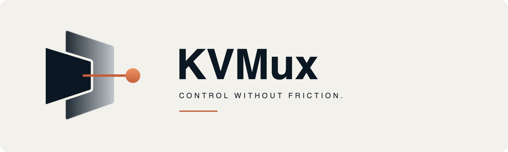

[English](README.md) | [简体中文](README.zh-CN.md)



# KVMux

通过 USB 采集卡查看另一台电脑的画面，并用 CH9329 控制它的键盘和鼠标。
采集卡和 CH9329 可以都接在运行 GUI 的电脑上，也可以由另一台电脑上的
`kvmux-relay` 经可信局域网提供。二者还可以分开放在不同电脑上。
被控电脑无需安装 KVMux。

## 准备硬件

- USB 采集卡，连接被控电脑的视频输出。
- CH9329 控制线或开发板。串口端连接运行 KVMux 或中继程序的电脑，USB HID 端连接被控电脑。
- 运行桌面 GUI 的电脑。没有直接插在这台电脑上的硬件，需要一台处于可信局域网中的中继电脑。

```text
被控电脑视频输出 ──> USB 采集卡 ──> KVMux 电脑
被控电脑 USB HID <── CH9329     <── 串口适配器

同一台电脑：桌面 GUI 使用采集卡和 CH9329
局域网：    硬件电脑运行 kvmux-relay <── 局域网 ──> 桌面 GUI
```

KVMux 使用外接硬件，不是软件屏幕共享工具。可用的采集模式取决于采集卡。
识别采集设备和串口适配器的方法见[硬件指南](docs/hardware-validation.md)。

## 获取 KVMux

按[构建指南](docs/building.md)从源码构建。仓库的 [CI](.github/workflows/ci.yml)
会构建和测试源码，但不发布安装包下载。构建需要 C++20 编译器、CMake、Ninja 和 FFmpeg 开发库（包括 avformat）。
Windows 构建需要在 MSVC 开发者命令行中运行。

macOS 用户安装 C++20 编译器和 CMake 后，可用 Homebrew 安装 Ninja 和 FFmpeg，
再从仓库根目录构建 Release 版本：

```sh
brew install ninja ffmpeg
cmake --preset macos-release
cmake --build --preset macos-release
open build/macos-release/kvmux.app
```

构建指南也列出了 Linux、Windows、Release 和无界面中继的预设。
macOS Developer ID 签名和公证尚未完成。Windows/Linux 硬件覆盖、持续性能和长时间运行稳定性仍未完成验证；
选择硬件前可查看[验证记录](docs/acceptance.md)。

## 使用本地硬件

1. 将采集卡和 CH9329 串口适配器接到运行 GUI 的电脑。
   macOS 本地采集需要允许摄像头访问；Linux 用户需要有权打开视频设备和串口。
2. 打开 **Connections**。**Video source** 保持 **Local device**。设置
   **Capture device**（采集设备）和 **Capture mode**（采集模式），然后选择
   **Start preview**。
3. **Control target** 保持 **Local serial**。设置 **Serial port**（串口）和
   **Baud rate**（波特率），然后选择 **Connect**。默认波特率为 **9600**；
   如果 CH9329 已改过配置，请使用它的实际波特率。
4. 等待实时画面和控制连接就绪。两者就绪后，连接弹窗会自动关闭。
   单击视频区域即可接管键盘和鼠标；这次激活单击不会发送给被控电脑。

## 输入 ASCII 文本

在本地文本或粘贴输入框中填入内容，然后选择 **Type**。这是一次需要明确发起的模拟输入，
不会转发 SDL 文本输入。KVMux 只接受美式键盘布局的可打印 ASCII 字符，以及 Tab 和 Enter；
其他字符会在输入开始前被拒绝，并可一键选择 **Remove unsupported**；该操作会保留受支持的
美式 ASCII、Tab 和 Enter 字符。移除后请再次选择 **Type**。请让被控电脑的目标输入框保持焦点，
并使用美式键盘布局，因为被控电脑会按模拟的按键解释文本。

输入有固定节奏和上限。可取消输入，或通过通常的 Host 键、焦点丢失或连接释放路径中止；
KVMux 会释放已按下的按键并停止剩余文本。剪贴板内容只留在本机，不会持久化或记录日志。
**Type ASCII** 仍会拒绝任何非 ASCII 字符。五笔输入没有实现。

## 向 Windows 目标输入中文

选择 **输入 → Chinese paste (Windows hex)**。这是另一个需要明确发起的动作。
选择 **Type ASCII** 时不会走这条路径。KVMux 不修改被控电脑。

开始之前，在接收按键的那台 Windows 上：

1. 为当前登录用户把 `EnableHexNumpad` 设为 `1`，然后注销并重新登录。仍无效果时再重启。

   ```text
   reg add "HKCU\Control Panel\Input Method" /v EnableHexNumpad /t REG_SZ /d 1 /f
   ```

2. 打开 NumLock。NumLock 关闭，或 KVMux 还没有读到这个灯时，这次动作不发送按键。
3. 把焦点放在 Notepad++ 或普通 Win32 编辑框上。不要用带 Markdown 工具栏的
   Win11 新版记事本：这个序列一开头会打开它的「插入链接」窗口。
4. 输入法需要放行这些按键。Notepad++ 里有过一次人工观察：英文模式和中文模式都打出了两个
   BMP 汉字。那一次观察不是平台验收。

控制目标必须是 **Local serial**，并且控制已经 Ready。Relay 不发送这种粘贴。
对话框会写明这些前提，并给出估算：大约每个字符 12 帧，再乘最近一次 ACK 往返。
界面标明这是估算。长文本仍然每个按键边等一次 ACK，字符上限与 ASCII 粘贴相同，为 65536。

Tab、Enter 和可打印的美式 ASCII 走原来的 ASCII 按键。BMP 内的其他字符走 Windows
十六进制序列。BMP 以外的字符、代理项，以及 Tab 和 Enter 以外的控制字符，会拒绝整段。
对话框显示拒绝了多少个以及原因，这段说明里不出现文本。KVMux 不会跳过它们后继续发送。

取消、失焦、画面过期、控制链路丢失和 ACK 超时都走与其他输入相同的释放路径，包括松开左 Alt。
链路已经丢失时，KVMux 不会把这次释放报成已确认。日志只记录计数、阶段和取消原因，
不记录文本、码点或十六进制串。

## 截图与录制

在顶部 **动作** 菜单，或 KVMux 标志悬浮按钮打开的菜单里操作。截图只保存原生解码后的视频，
不会包含菜单、鼠标指针或状态显示；文件保存到系统的 **Downloads** 文件夹，命名为
`kvmux_YYYYMMDD_HHMMSS.jpeg`。如有同名文件，KVMux 会添加后缀。

**Screenshot: Full screen** 保存整帧。**Screenshot: Region** 保存已确认的区域。
**Recording: Full screen** 把整帧录成 H.264 MP4，不需要先选区域。
**Recording: Region** 只录已确认的区域。两条录像走同一条裁剪路径：全屏就是裁剪
`{0, 0, 宽, 高}`。确认区域时会就地对齐到偶数：左边和上边落到不大于选区的偶数像素，
右边和下边落到不小于选区的偶数像素，并夹在偶数化后的画面尺寸里。轮廓、区域截图、
区域录像和滚动截图用的都是对齐后的区域。对齐后小于 2×2 像素不会保存，通知里会说明。
录像或滚动截图若仍因裁剪被拒绝，通知里显示具体原因。
文件在 **Downloads**，命名规则与截图相同。**Pause**、**Resume**、**Stop** 仍然可用；
**Stop** 会等文件写完。截图和录制只留在本机。

**Select region** 之后，画面上会提示拖动选区。松开鼠标后，区域旁边有 **确认** 和
**取消**。点 **确认** 或按 Enter 保存，Esc 或 **取消** 退出且不保存。选区过程中的鼠标
不会发给被控电脑。Host 键仍然只在本机起作用。已保存的区域会一直画在预览上，直到
**Clear region**。**Start scrolling** 仍然需要已保存的区域和控制连接。灰色菜单项会说明
缺什么，例如还没有区域。

H.264 MP4 录制需要 FFmpeg 提供 H.264 支持；不可用时 KVMux 会显示明确错误。
录制采用有界的最新帧写入器，电脑负载过高时可能丢帧。此功能尚未在真实硬件上验证。

## 通过局域网连接

**仅在可信局域网中使用。** 中继没有身份认证或加密。
任何能访问中继端口的人都可能尝试控制被控电脑，不要将这些端口暴露到互联网。

GUI 分别选择 **Video source** 和 **Control target**。Hello 的角色必须与
`kvmux-relay` 进程完全一致。同时提供视频和键鼠的中继不接受只出视频或只做键鼠的客户端；
单一角色的中继也不接受合并客户端。GUI 显示 `角色不匹配`。

1. 在连接硬件的 Windows 或 Linux 电脑上，按[局域网快速入门](docs/lan-relay.md)构建并启动中继。
   对于已构建的 Linux Debug 无界面版本，如果采集卡和可识别的串口适配器在同一台电脑上，可运行：

   ```sh
   build/linux-debug-headless/kvmux-relay --serve
   ```

   如果自动选择失败，按指南列出设备，再明确指定采集模式和串口。
2. 在这台中继电脑的防火墙中允许 UDP **17000**（控制）和 **17001**（视频）入站，
   并将访问范围限制在预期的局域网内。只做键鼠的中继只监听控制端口。
   只出视频的中继仍然同时监听控制端口和视频端口。
3. 在 GUI 中打开 **Connections**。对于这台同时提供视频和键鼠的中继，把
   **Video source** 和 **Control target** 都设为 **Relay**。在 **Video host**
   和 **Control host** 中填写它的局域网地址。如果没有修改端口，**Video control
   port** 和 **Control port** 保持 `17000`，**Video port** 保持 `17001`。
   主机和控制端口相同的时候，GUI 使用一个合并客户端。
4. 选择 **Connect relay**。等待实时画面和控制连接就绪，再单击视频区域接管输入。
   目前只支持一个控制端。

采集卡和 CH9329 可以放在不同电脑上。下面三种 GUI 组合都没有硬件实测记录，
也没有手动操作 GUI 的记录。`--no-capture` 和 `--no-serial` 不能同时使用。

1. 本机采集，键鼠走另一台电脑。在串口电脑上：

   ```sh
   build/linux-debug-headless/kvmux-relay --serve --no-capture --serial "/dev/ttyUSB0" --baud 9600
   ```

   GUI：**Video source** 选 **Local device**，**Control target** 选 **Relay**。
2. 一台中继只出视频，另一台只做键鼠。采集电脑使用 `--serve --no-serial`，
   串口电脑使用上面的 `--no-capture` 命令。GUI 两个选择器都选 **Relay**，
   主机不同，或者控制端口不同。

   ```sh
   build/linux-debug-headless/kvmux-relay --serve --no-serial --device "/dev/video0" --mode-index 0
   ```

3. 视频来自中继，CH9329 接在 GUI 电脑上。采集电脑使用上面的 `--no-serial`
   命令。GUI：**Video source** 选 **Relay**，**Control target** 选 **Local serial**。

只做键鼠的中继信任 GUI 对画面是否新鲜的声明，它自己看不到画面。
只出视频的中继仍用控制端口完成握手。端口、角色匹配和未验证状态见
[局域网配置](docs/lan-relay.md#put-the-capture-card-and-the-ch9329-on-different-computers)。

网络视频默认使用 MJPEG。可选的 H.265 编码需要原始视频采集，不支持将 MJPEG 转码为 H.265。
编码器要求和 GUI 的 **Decode** 设置见 [H.265 配置](docs/lan-relay.md#choose-h265-encoding)。

## 释放输入与打开菜单

按 **Host 键**可退出接管，返回 Preview。Host 键不会发送给被控电脑。
macOS 默认使用 **右 Command**，Windows/Linux 默认使用 **右 Control**。
也可以在 **Connections** 中更改：macOS 可选 **Host: Right Control**，
Windows/Linux 可选 **Host: Right GUI**。

输入接管或恢复期间，顶部菜单会隐藏。单击半透明的 KVMux 标志悬浮按钮可释放输入并打开菜单，
拖动按钮可调整位置，拖动操作不会发送给被控电脑。在 **Relative** 鼠标模式下，需要先按 Host 键解锁指针。
全屏时，释放输入后将指针移到顶部边缘，也可显示顶部菜单。
**Status overlay** 可切换底部状态显示，**Diagnostics** 可查看连接详情。
悬浮按钮位置和状态显示开关不会保存。

系统保留的快捷键可能仍由本机处理。需要时，可使用 **Connections** 中的
**Send Ctrl+Alt+Del** 或 **Send Alt+Tab**。如果串口断开后被控电脑仍有按键或鼠标按钮处于按下状态，
软件无法确认释放是否送达；必要时重新连接被控电脑的 USB HID 线。
视频、输入或串口故障的排查方法见[局域网故障排查](docs/lan-relay.md#troubleshooting-video-appears-but-input-does-not-work)。

## 更多文档

- [构建选项与依赖](docs/building.md)
- [局域网配置与故障排查](docs/lan-relay.md)
- [Linux 下配置 CH9329 波特率](docs/ch9329-baud.md)
- [硬件识别](docs/hardware-validation.md)与[验证状态](docs/acceptance.md)
- 面向贡献者的[技术设计](docs/design/kvm-technical-design-v1.md)
